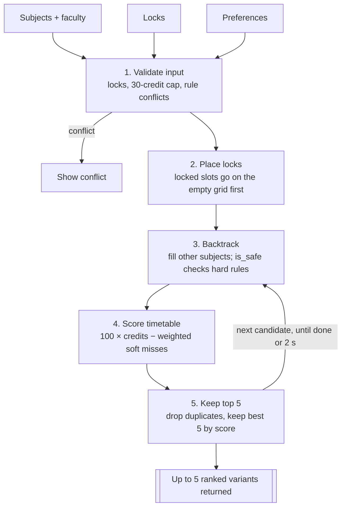

# SlotWizard PRD — Scheduler v2

Nov 9, 2026 · [Live doc](https://claude.ai/artifact/CqNvzBKNsM57F3RrYfDUrm)

**Status:** implemented in Phases 0–5 (see [PHASES.md](PHASES.md)). All acceptance criteria below are met and covered by the backend tests (`cd backend && npm test`).

## Overview

Scheduler v2 gives students more control over their timetable: five ranked options instead of one, scoring that follows their time preferences, and the ability to lock choices before regenerating.

SlotWizard is a planning tool for students. The college website publishes each semester's subjects, slots and faculty, and students register there with a cap of 30 credits per semester. SlotWizard takes those offerings, lets a student pick subjects and preferred faculty, and builds a clash-free weekly timetable (Monday–Saturday, 4 two-hour slots a day) using a backtracking scheduler.

SlotWizard is not a registration system. It has no admin role, seat counts or enrollment totals, and this release adds none.

## Already shipped

The core flow already works end to end: sign up, pick subjects and faculty, generate a timetable, view it, edit it and regenerate.

| Area | Feature | Where |
| --- | --- | --- |
| Auth | Sign up and log in with bcrypt-hashed passwords and a JWT in an httpOnly cookie; log out | `userController.js`, `authMiddleware.js` |
| Auth | Protected pages redirect to login when the session is invalid | `MainPage.jsx`, `TimeTable.jsx` |
| UI | Landing page with animated particles; dark and light theme | `LandingPage.jsx`, `ThemeProvider.jsx` |
| Enrollment | Search subjects by name or code; add up to 13 subjects | `MainPage.jsx`, `EnrollmentPanel.jsx` |
| Enrollment | Choose preferred faculty per subject and see their slots | `EnrollmentPanel.jsx` |
| Scheduler | Backtracking engine that never double-books a slot, handles 2-day and lab slots, and keeps the timetable with the most credits | `timetableService.js` |
| Scheduler | Lists the subjects that could not be fitted | `timetableService.js`, `TimeTable.jsx` |
| Timetable | Weekly grid (6 days × 4 slots) with subject, slot and duration | `TimeTable.jsx` |
| Timetable | Last 10 generated timetables saved per user; Previous/Next moves between them | `user.js`, `TimeTable.jsx` |
| Timetable | Edit loads a saved timetable's selections back into enrollment; New starts fresh | `TimeTable.jsx` |
| Validation | Basic form validation and error toasts | `SignUpPage.jsx`, `Login.jsx` |

Written but not wired up: `editProfile` and `changePassword` exist in the controller but have no routes, and the Profile page is still a stub. The 30-credit cap is enforced by the scheduler (Phase 0), not at selection: students can select up to 13 subjects, over 30 credits, so a clash on one subject doesn't cost them the semester. The generated timetable never goes over 30.

## Goals, non-goals and success metrics

**Goals**

- Let students compare up to 5 genuinely different clash-free timetables from one generation.
- Rank timetables by what the student cares about (mornings, free days, gaps), not by credits alone.
- Let students keep the parts they like and regenerate only the rest.

**Non-goals**

- Admin tools, seat limits or enrollment counts. Offerings come from the college website.
- Registering on the college portal for the student.
- Changing the slot grid (6 days × 4 slots).

**Success metrics**

| Metric | Target |
| --- | --- |
| Generation time for 13 subjects with all preferences on | Under 2 seconds on the server |
| Distinct variants returned when at least 5 valid timetables exist | 5 of 5 |
| Locked subjects that keep their locked slot in every variant | 100% |
| Timetables that break a hard preference | 0 |

## Feature 1: Top 5 timetable variants

One Generate click returns up to 5 ranked, distinct timetables, and the student picks the one to save.

**Problem.** Today the scheduler keeps only the single highest-credit result. Ties are broken by search order, so a student never sees an equally good timetable with a free Saturday. Previous/Next shows older generations, not alternatives.

**Requirements**

1. The scheduler keeps the best 5 complete timetables, ranked by score (Feature 2 defines the score).
2. Two variants count as distinct only if they differ in at least one subject's slot, or in which subjects are included. Duplicates are dropped.
3. Fewer than 5 valid timetables → return all of them and show "Only N possible timetables".
4. Each variant has its own score, total credits and missed subjects.
5. The search stops after a time budget (default 2 s) and returns the best found so far, marked "partial".

**UX**

- After generating, the timetable page shows variant tabs: Option 1 … Option 5, with credits and score on each tab.
- A Compare toggle highlights the cells that differ from Option 1.
- "Save this one" saves the chosen variant to history. The current Previous/Next history moves into a "Saved timetables" list.

**Acceptance criteria**

- [x] With 13 subjects and several faculty per subject, Generate returns 5 variants with no repeated timetable.
- [x] Variants are sorted by score, highest first.
- [x] Each variant is clash-free and stays within 30 credits.
- [x] Saving a variant adds exactly one entry to history; the 10-entry limit still applies.

## Feature 2: Time preferences

Students set preferences about when they study. Each one is either a hard rule, which is never broken, or a soft wish, which counts toward the score.

**Preferences offered**

| Preference | Example | Can be hard? |
| --- | --- | --- |
| Avoid the 8:00–10:00 slot | "No early classes" | Yes |
| Avoid the 3:00–5:00 slot | "Leave early" | Yes |
| Keep chosen days free | "Saturday free" (any of Monday–Saturday) | Yes |
| Fewer gaps | No free slot between two classes on the same day | No (soft only) |
| Max classes per day | e.g. at most 3 of 4 slots | Yes |

**Scoring.** Credits stay the main goal, so a preference never costs a subject unless the student makes it a hard rule. Each slot is 2 hours, so every soft preference compares at the same scale:

```
score = 100 × credits − Σ (weight_p × violations_p)   for each soft preference p
```

Weights: Low = 5, Medium = 15, High = 40. One extra credit (100) outweighs two High violations (80); three High violations (120) outweigh one credit.

**Requirements**

1. Hard rules are checked inside `is_safe`, so slots that break them are never tried.
2. Soft rules are scored once a timetable is complete.
3. Preferences are saved on the user and reused next time; they can be changed before each generation.
4. Each variant shows which soft preferences it broke, e.g. "1 class at 8:00 on Wednesday".
5. If hard rules leave a required subject with no possible slot, list it under missed subjects with the reason "blocked by your preference: Saturday free".

**UX**

- A collapsible Preferences panel on the enrollment page, above Generate.
- Each row: a toggle, a Hard/Soft switch, and Low/Medium/High weight for soft rules.

**Acceptance criteria**

- [x] With "Saturday free" set to hard, no variant has a class on Saturday.
- [x] With "Avoid 8:00" set to soft High, a timetable with fewer 8:00 classes ranks above one with equal credits and more.
- [x] Preferences survive logout and login.
- [x] Generation with every preference on still meets the 2 s target. (Median 16 ms over 31 test sets; only an extreme set, the 13 most-sectioned subjects, uses the full 2 s and returns a near-best result marked "stopped early".)

## Feature 3: Lock a subject or faculty and regenerate

Students pin the choices they are happy with, and the scheduler rebuilds everything else around them.

**Lock types**

| Lock | Meaning | Set from |
| --- | --- | --- |
| Lock slot | This subject must use this exact slot (and so this faculty) | A filled cell on the timetable grid |
| Lock faculty | This subject must be taught by this faculty, in any of their slots | Enrollment panel, per subject |
| Must include | This subject must appear; any of the preferred faculty is fine | Enrollment panel, per subject |

**Requirements**

1. Locked slots are placed on the empty grid first; the backtracking then fills only the remaining subjects.
2. If two locks clash, or a lock breaks a hard preference, Generate is blocked and the conflict is named, e.g. "19AI553 and 19ME533 both lock Thursday 8:00".
3. Must-include subjects are never skipped. If one cannot fit, the result says why instead of dropping it silently.
4. Locks count toward the 30-credit cap of the generated timetable.
5. Locks are saved with the timetable, so Edit reopens them.
6. All 5 variants keep every lock.

**UX**

- A lock icon on each filled timetable cell, and on each subject card in enrollment.
- Locked cells get a padlock and a thicker border.
- A "Regenerate around locks" button on the timetable page that runs without going back to enrollment.
- "Clear all locks" next to it.

**Acceptance criteria**

- [x] Locking a cell and regenerating keeps that subject in the same slot in all variants.
- [x] Locking faculty X for a subject means no variant has another faculty for it.
- [x] Two clashing locks show an error and send no generate request.
- [x] Edit on a saved timetable restores its locks.

## Technical design

All three features change one function, `generateTimetable` in `timetableService.js`, plus the request body and two saved fields.



A lock or hard-rule conflict stops the run before any search; otherwise the search keeps going until every branch is tried or the 2 s budget runs out.

**Scheduler changes**

- Replace `final_res` / `final_score` with a top-5 list sorted by score. A complete timetable enters the list if it beats the 5th entry.
- Dedupe with a key built from the sorted `code:slot` pairs.
- Prune: if current score + 100 × (credits of the remaining subjects) cannot beat the 5th entry, stop that branch. This keeps the search fast once there are 5 results.
- Pass hard preferences into `is_safe`; pre-place locks and remove those subjects from the search list.
- Must-include subjects lose the "skip this subject" branch.
- Skip a placement that would take the total over 30 credits.
- Check `Date.now()` every 1,000 calls and stop at the budget, returning `partial: true`.

**API**

| Endpoint | Change |
| --- | --- |
| `POST /timetables` | Body adds `locks` and `preferences`; returns `variants[]` and `partial` instead of one timetable. Nothing is saved. |
| `POST /timetables/save` | New. Saves the chosen variant to history (10-entry limit). |
| `GET /preferences`, `PUT /preferences` | New. Read and update saved preferences. |

```json
{
  "subjects": [{ "code": "19AI553", "staff": ["..."], "mustInclude": true }],
  "locks": [{ "code": "19ME533", "slot": "4N5-1" }],
  "preferences": {
    "avoidEarly": { "on": true, "hard": false, "weight": "high" },
    "freeDays": { "on": true, "hard": true, "days": ["Saturday"] }
  }
}
```

**Data model** (`user.js`)

- `user.preferences`: the saved preference settings.
- Each entry in `user.tables` adds `locks`, `credits` and `brokenPreferences`, so Edit can restore locks.

## Rollout, risks and open questions

Build in this order. Each step ships on its own, and each later feature reuses the scoring and top-5 list from the step before it.

1. **Groundwork**: enforce the 30-credit cap in the scheduler (selection stays open, so students can over-select); show selected credits on the enrollment page; add unit tests for `generateTimetable` with fixed inputs.
2. **Top 5 variants**: top-5 list, dedupe, pruning, time budget; variant tabs and the new save endpoint.
3. **Time preferences**: preferences panel, hard rules in `is_safe`, soft scoring, saved preferences.
4. **Locks**: lock icons, pre-placement, must-include, conflict messages, "Regenerate around locks".

**Risks**

| Risk | Mitigation |
| --- | --- |
| Keeping 5 results weakens pruning, so generation slows with 13 subjects | Bound-based pruning plus the 2 s budget with `partial: true` |
| Top 5 differ by one tiny swap and feel the same | Dedupe key; optionally require variants to differ in at least 2 subjects |
| Too many hard rules leave no valid timetable | Name the rule that blocked each missed subject |
| Changing `POST /timetables` breaks the current page | Ship backend and frontend together, or accept the old `timetable` body for one release |

**Open questions (answered)**

- *Is 13 the right maximum for selected subjects?* Kept 13, now a hard lock in the UI and enforced by the API.
- *Should variants have to differ in at least 2 subjects?* Not yet: options must differ, and must not leave out a subject that fits, but often differ by one section swap. Revisit if students find options too similar.
- *Is 2 s the right budget?* Yes. Typical generation takes milliseconds; 2 s is a safety net that returns the best found so far.
- *Class times outside 8:00, 10:00, 13:00 and 15:00?* 13 subjects have such sections. Each class hour now goes in the 2-hour block it falls in (e.g. 9:00–11:00 takes the 8:00 and 10:00 blocks), so none cause hidden clashes. This also fixed 6- and 8-hour sections, which used to be placed in only 2 of their blocks. Hours with no block (e.g. 12:00) make that section unplaceable, with a clear reason.
